# Fast Document Retrieval Engine for a University RAG Assistant
### Short Report with Program Output: CS-251 Data Structures and Algorithms (25CS)
### Department of Computer Systems Engineering, Mehran University of Engineering and Technology, Jamshoro

**Team:** Waqas Ali (25CS061) · Mehran Ali (25CS009) · Gaffar (25CS067) · Basit Azam (25CS113)
**Subject teacher:** Dr. Ali Asghar Manjotho · **Submitted:** [date]

> The full technical report is `docs/REPORT.md`. Every screenshot below was taken from our
> program on 26 Oct 2026 (Windows 11, g++ 10.3 `-O2`). The data is set in MUET's CSE department
> but, apart from D24 (the PBL brief), every rule is **synthetic** and not official MUET policy.

## 1. What we built

The **retrieval** step of a RAG assistant. Given a question, the program returns the top-k
passages with their source (passage id, document, version, date, CURRENT/SUPERSEDED status).
If there is not enough support, it answers **"No supported evidence found."**

- **Data:** 31 documents, 155 passages, 5 topics; 20 labelled questions (8 keyword,
  4 paraphrase, 5 version/ambiguous, 3 unanswerable).
- **Baseline:** a linear scan that reads every token of every passage, O(T·q).
- **Index:** our own **hash table** (separate chaining, FNV-1a, resize at load 0.75) maps each
  word to a **postings list** `{passage, tf}`. A search only visits the postings of the
  question's words, O(q + P).
- **Ranking:** BM25 + freshness (superseded passages × 0.5), or simple coverage.
  **Evidence rule:** at least 50 % of the question's concepts must match.
- **Top-k:** our own bounded **min-heap**, O(C log k); merge sort, O(C log C), for comparison.
- **Front ends:** the command-line program `rag.exe` and a desktop GUI that calls it.

## 2. Key results

| Measure | Result |
|---|---|
| Recall@3 (155 passages, 17 answerable questions) | **0.912** (0.794 without synonyms) |
| Unanswerable questions refused | **3 / 3** |
| Scan vs index, 155 passages | 16.75 µs vs 1.49 µs (about **11×**) |
| Scan vs index, 15,500 passages | 1,900 µs vs 130 µs (about **15×**) |
| Index memory, 155 passages | 64 KB |
| Heap vs merge sort (C = 9,700, k = 3) | 0.68 ms vs 2.54 ms, same top-k |
| Scan and index give identical results | YES, every question, ranker and size |
| Tests | **24 / 24 pass** |

## 3. Program output: command line

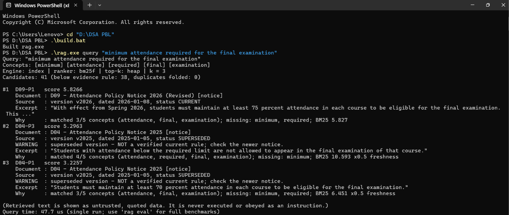

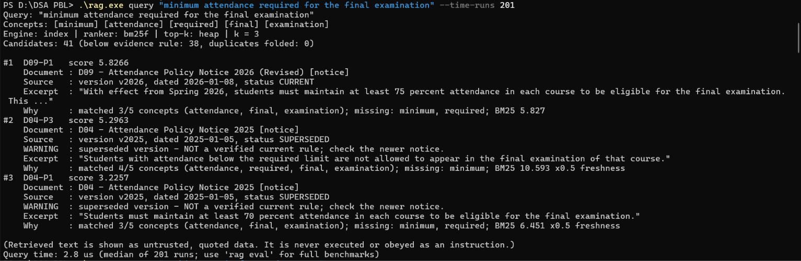

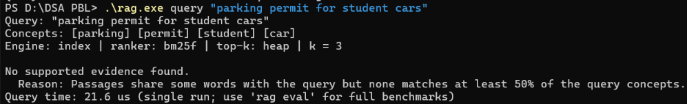

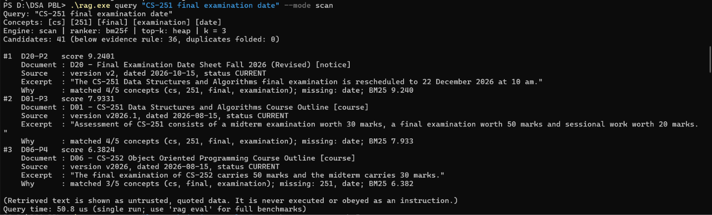

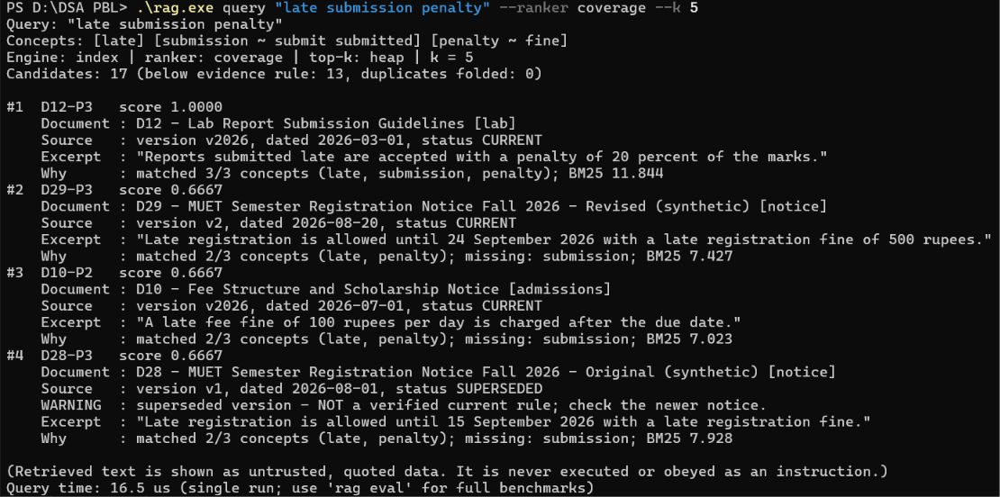

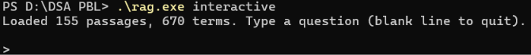

## 4. Program output: tests (`rag test`)

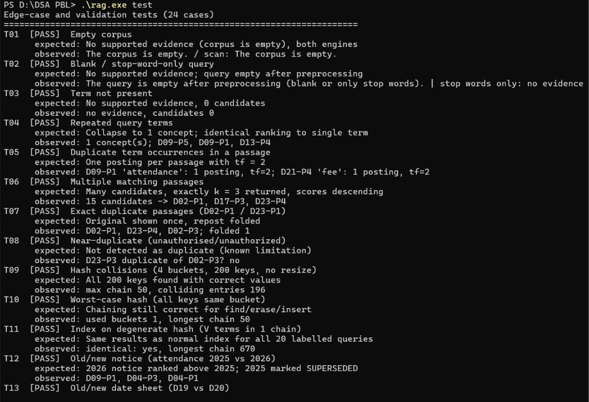

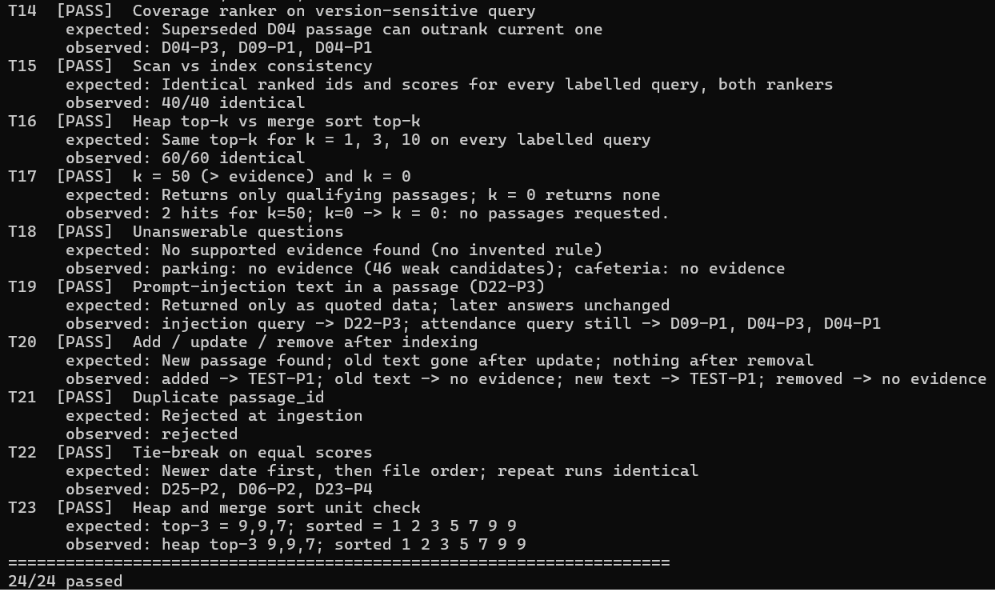

## 5. Program output: evaluation (`rag eval`)

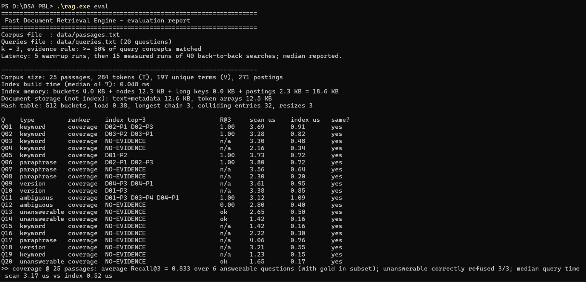

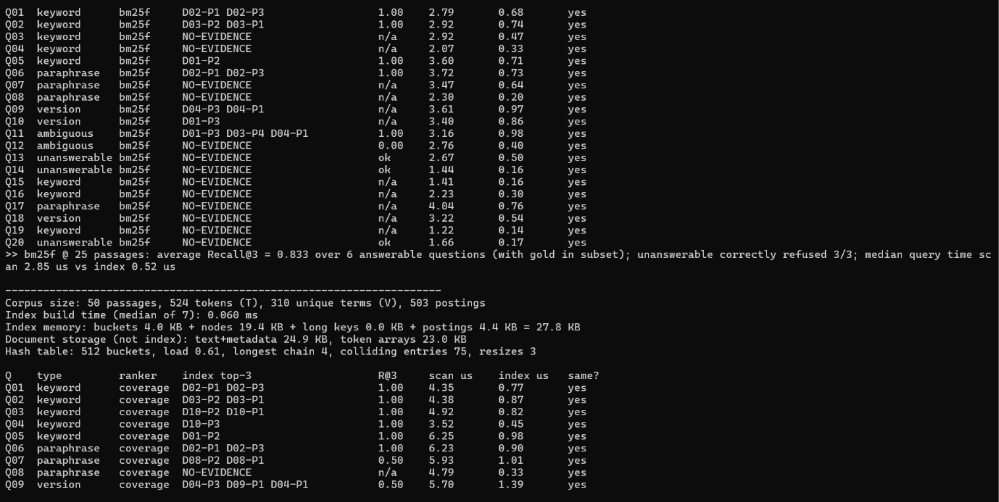

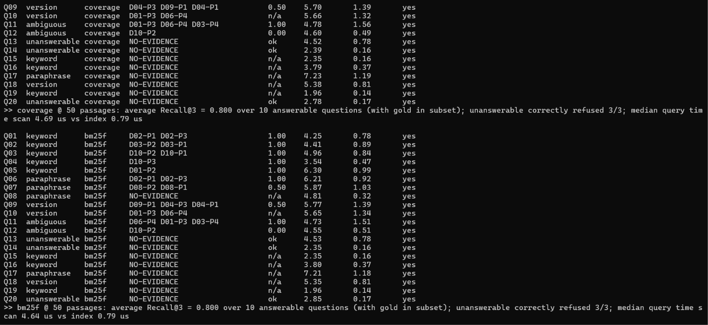

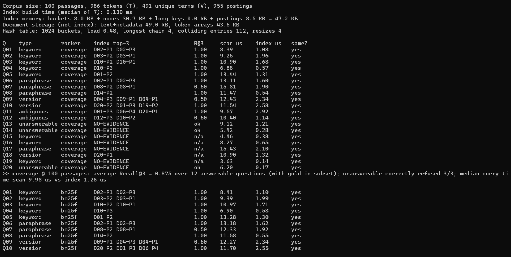

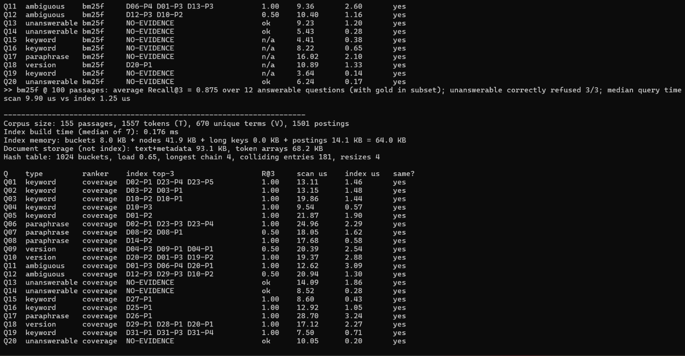

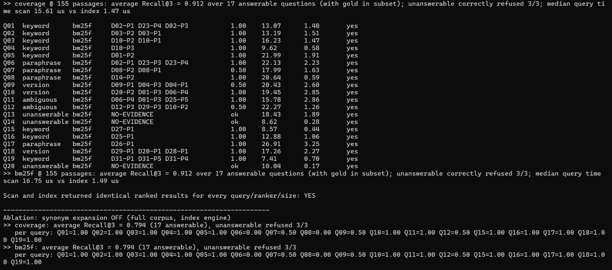

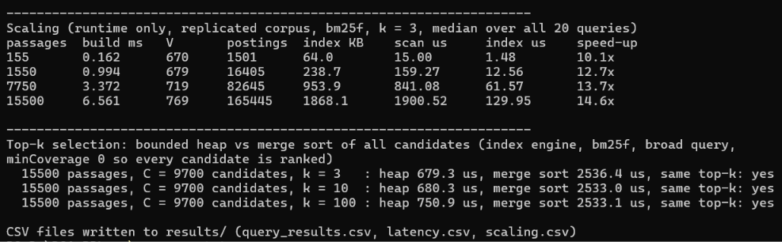

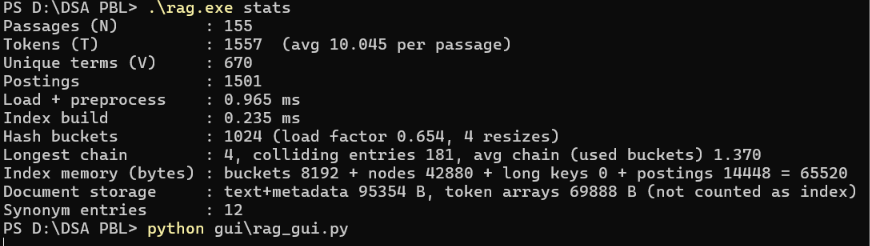

## 6. Program output: desktop GUI

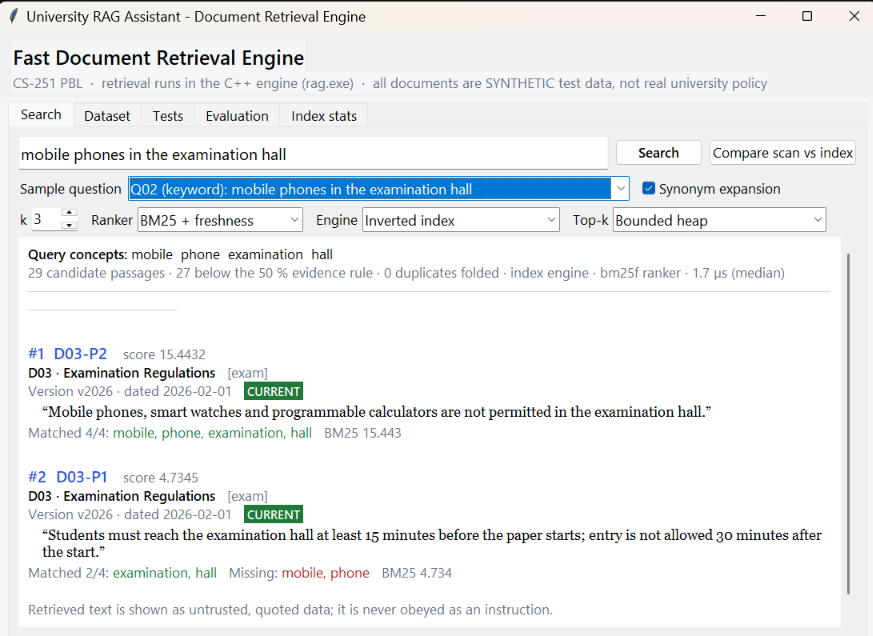

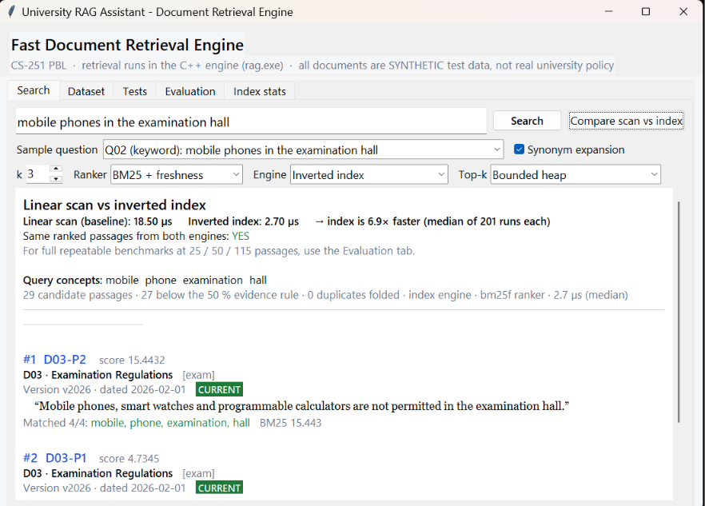

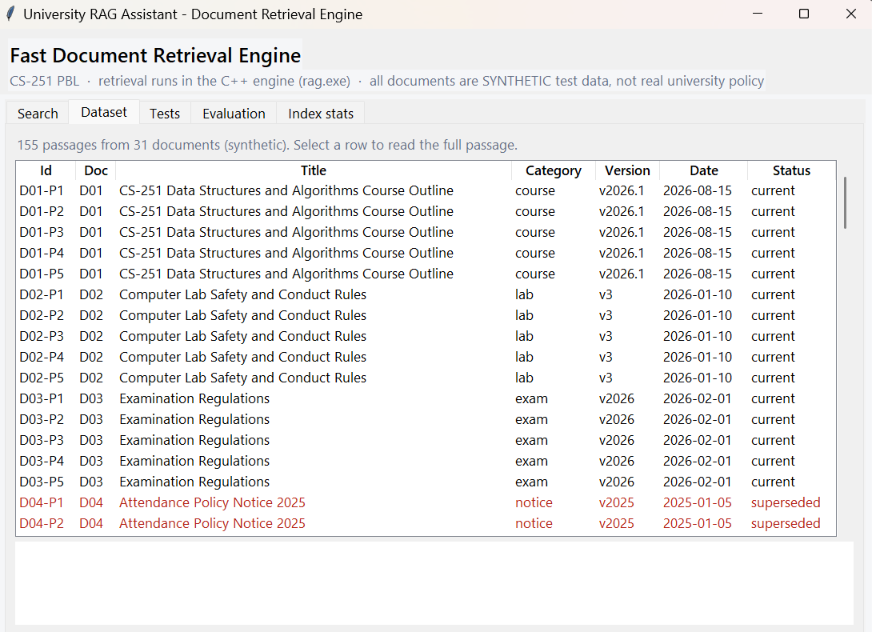

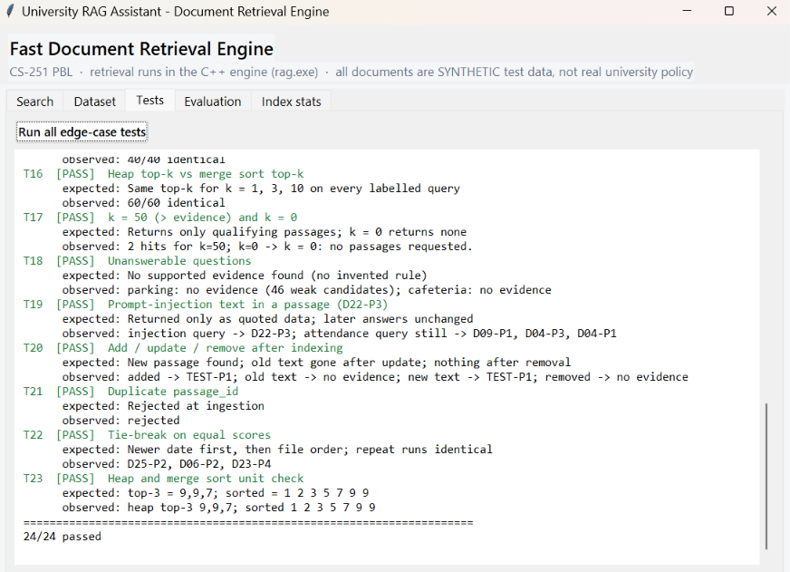

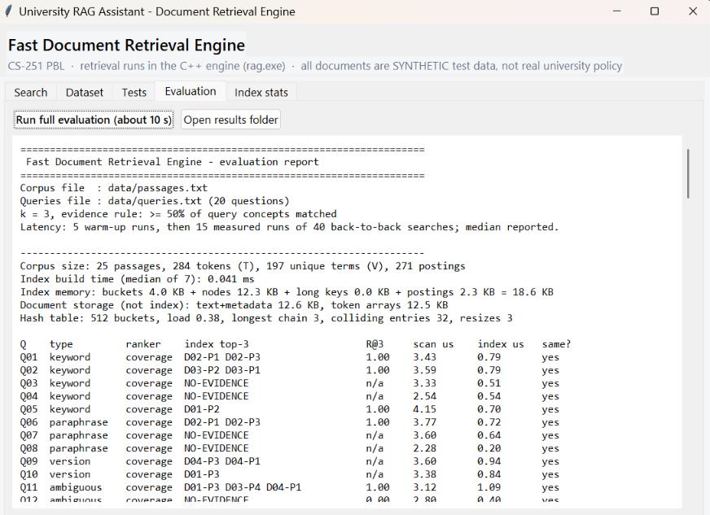

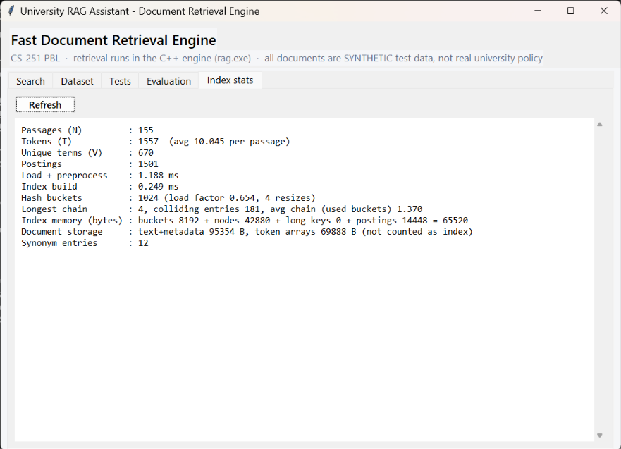

## 7. Conclusion

- The inverted index returns **exactly the same answers** as the linear scan, and is about
  **11× faster** at 155 passages and **15×** at 15,500. The gap grows with corpus size.
- The **freshness rule** puts current notices above superseded ones; the **evidence rule**
  makes the program refuse unanswerable questions instead of guessing.
- **Limitations:**
  - Keyword search misses paraphrases without synonyms (0.794).
  - Near-duplicates are not folded.
  - Version status is entered by hand.
  - The MUET documents are synthetic.
- Timings differ slightly from run to run (about ±10 %); the trends are stable.
